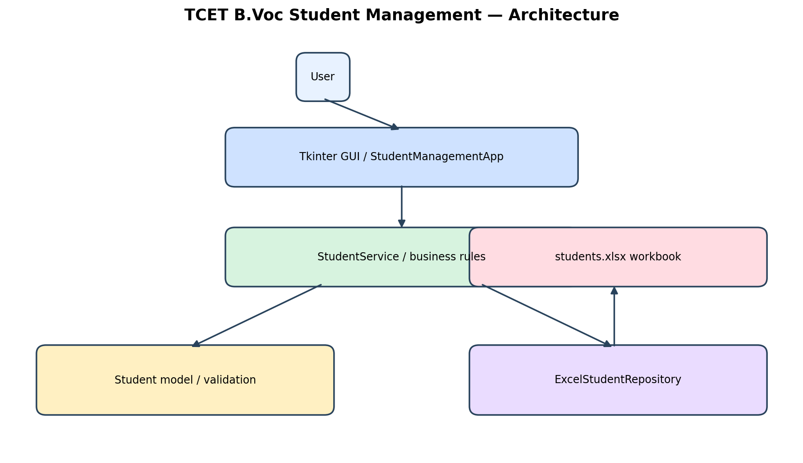
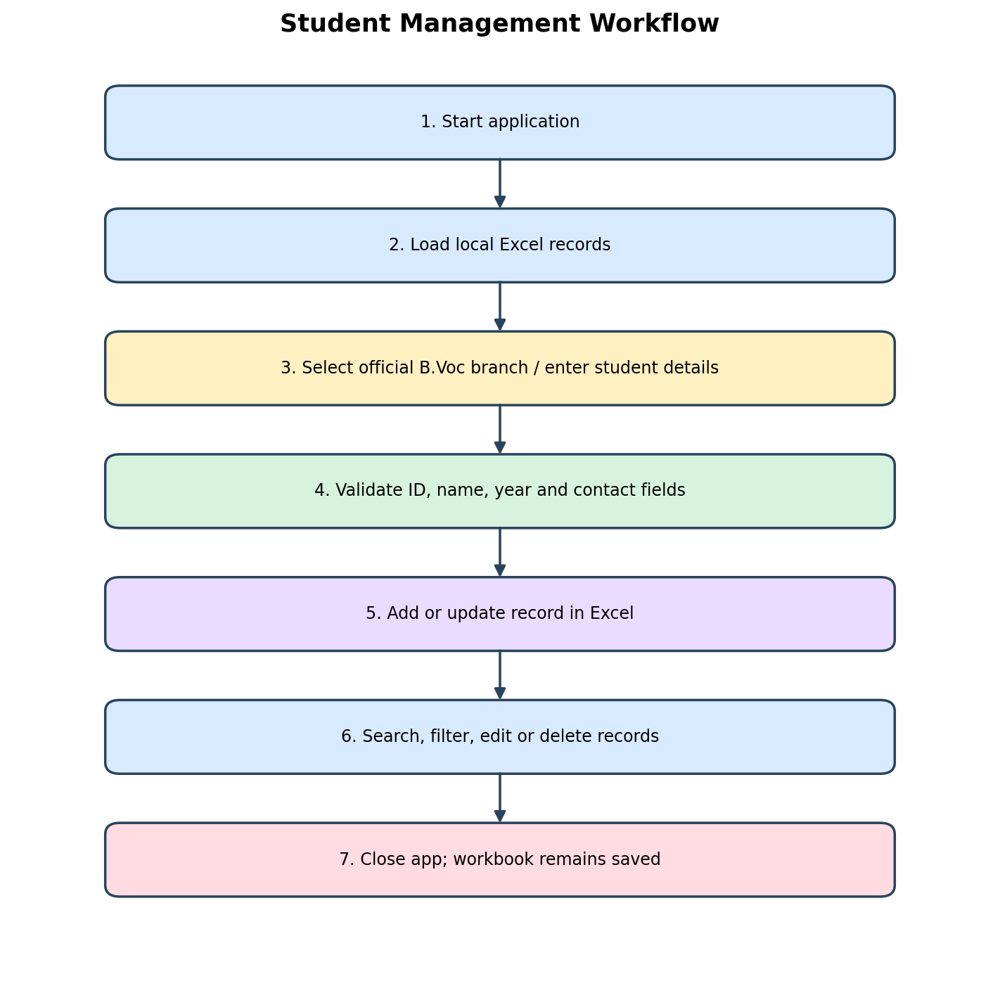

# TCET B.Voc Student Management System

A desktop student-record application built with Python, Tkinter, object-oriented programming, and Excel (`openpyxl`). It runs locally and stores records in an Excel workbook.

## Features

- Add new student records
- Update a record by saving another record with the same Student ID / PRN
- Delete a selected record
- Search across student details
- Filter records by B.Voc branch
- Validate required fields, email addresses, phone numbers, year, semester, and status
- Refresh the public B.Voc branch list from TCET when internet access is available
- Automatically create and update `data/students.xlsx`

## Requirements

- Python 3.10 or newer
- Tkinter, usually included with Python on Windows and macOS
- Internet access is optional. It is only needed for **Refresh Branches**.

On Windows, make sure **Add Python to PATH** was selected when Python was installed. You can check the installation with:

```powershell
python --version
```

If the `python` command is not available, try the Python launcher:

```powershell
py --version
```

## Installation and startup

Open PowerShell in the project folder, the folder containing `main.py`, and run:

```powershell
python -m venv .venv
.\.venv\Scripts\Activate.ps1
python -m pip install -r requirements.txt
python main.py
```

To start the application again later:

```powershell
.\.venv\Scripts\Activate.ps1
python main.py
```

If PowerShell blocks activation, run the following once for the current user, then activate the environment again:

```powershell
Set-ExecutionPolicy -Scope CurrentUser RemoteSigned
```

On macOS or Linux, use the equivalent commands:

```bash
python3 -m venv .venv
source .venv/bin/activate
python -m pip install -r requirements.txt
python main.py
```

Some Linux distributions require a separate Tk package, commonly named `python3-tk`.

## How to use the application

1. Start the application with `python main.py`.
2. Enter the Student ID / PRN and full name.
3. Select the B.Voc branch, year, semester, academic year, and status.
4. Enter email and phone if available. These fields are optional but validated when filled.
5. Click **Add / Update Student**. The record is saved to `data/students.xlsx`.
6. Select a row to load it into the form. Edit the fields and save to update it.
7. Use **Search** to find matching text in any displayed student field.
8. Use **Branch filter** to show records for one branch.
9. Select a row and click **Delete Selected** to remove it after confirmation.
10. Click **Clear Form** before entering another record.

The Student ID / PRN is the unique key. Saving another student with the same ID updates the existing record instead of creating a duplicate.

## Data and validation

The workbook is created automatically at:

```text
data/students.xlsx
```

The application validates these values:

- Student ID / PRN and full name are required.
- Year must be `FY`, `SY`, `TY`, or `Fourth Year`.
- Semester must be from `I` through `VIII`.
- Status must be `Active`, `Graduated`, or `On Hold`.
- Email must have a valid basic email format when supplied.
- Phone may contain digits, spaces, `+`, parentheses, or hyphens and must be 7 to 20 characters.

Back up `data/students.xlsx` before making manual changes. Keep the workbook secure because it contains student information.

## B.Voc branch list

The bundled branch list contains:

1. Artificial Intelligence and Data Science
2. Software Development
3. Animation and Graphic Designing
4. Data Analytics
5. Data Science
6. Artificial Intelligence

Click **Refresh Branches** to attempt to load current public branch names from TCET. If the request fails, the bundled list remains available for offline use. Confirm current course availability with TCET.

Official references:

- [TCET B.Voc enquiry page](https://www.tcetmumbai.in/bvoc-enquiry.html)
- [TCET admission page](https://admission.tcetmumbai.in/bvoc.php)

## Architecture and workflow

### Architecture



The user interacts with the Tkinter interface. `StudentService` applies business rules and uses `Student` for validation. `ExcelStudentRepository` reads and writes the local Excel workbook.

### Student workflow



The normal flow is: start the app, load local records, enter and validate details, save or update the workbook, search/filter/edit/delete records, and close the app. Saved records remain in the workbook after the application closes.

## Project structure

```text
tcet_bvoc_student_management/
├── main.py                    # Application entry point
├── requirements.txt           # Python dependencies
├── README.md                  # This guide
├── data/
│   └── students.xlsx          # Created automatically at runtime
├── diagrams/
│   ├── architecture.png       # Component diagram
│   └── workflow.png           # User workflow diagram
├── docs/
│   └── PROJECT_STRUCTURE.md   # Short structure reference
├── src/
│   ├── models.py              # Student model and validation
│   ├── branch_catalog.py      # Branch list and public refresh
│   ├── excel_repository.py    # Excel CRUD operations
│   ├── student_service.py     # Business logic
│   └── student_app.py         # Tkinter user interface
└── tests/
	└── test_models.py         # Model validation tests
```

## Running tests

With the virtual environment activated, run:

```powershell
python -m unittest discover -s tests -p "test_*.py" -v
```

## Privacy

This is a local student-record tool. It does not download private student information from TCET. The branch refresh only attempts to read public B.Voc programme names. Enter student records only when you are authorized to handle them, and do not commit `data/students.xlsx` to a public repository.

## Troubleshooting

### `ModuleNotFoundError: No module named 'openpyxl'`

Activate the virtual environment and install the requirements:

```powershell
.\.venv\Scripts\Activate.ps1
python -m pip install -r requirements.txt
```

### The application does not open

Run it from the project root, where `main.py` and the `src` folder are present:

```powershell
python main.py
```

### Branch refresh fails

Check the internet connection and try again. The application keeps the bundled branch list and student records remain local.
